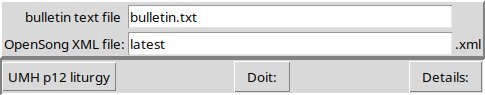
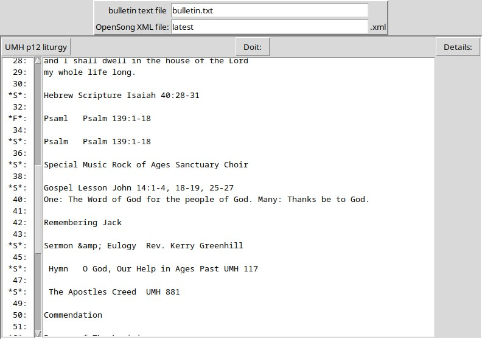

bull2pres.py
Is a python script that generates an OpenSong set file
from a bulletin text file.

It is not terribly smart. It looks for character strings that are typical in our
worship service bulletin, ie Hymn, Sermon, Anthem
and generates a new slide for them.
The OpenSong set file is an .xml file.
Some headings, like Hymn, refer to external files. 
The file structure to find those external files is declared in the script.

There is a simple GUI built with TKinter. 
When you start up the script without any arguments it look like this

There are several options available for Communion liturgy. 
Select one from the menu button on the left (if there is Communion).

"Doit" will generate the Set file. "Details" will show something like this:

In the left column, "S" indicates a recognized heading for which a slide was generated.
Slides, like "Hymn" use the info to generate more than just the simple text in that line.

When the set is opened in the OpenSong editor, stuff that 
the script was not smart enough to include can be copied and pasted from here.
The script is not terribly smart. If something is not exactly what is is looking for, but maybe close
it will flag it but not generate a slide for it. 
Notice that the Psalm was included twice, but misspelled the first time. 
The script marked that line with "F" in the left margin.
